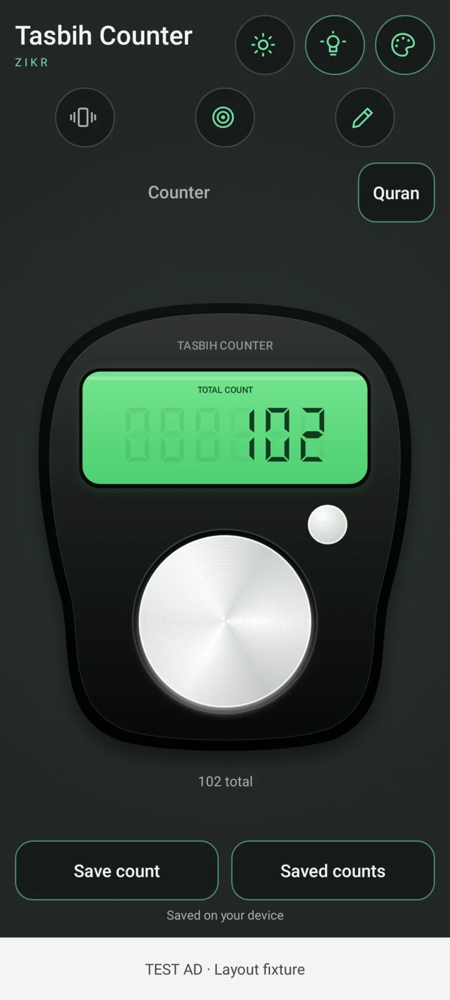

# Tasbih Counter - Zikr

A simple Android counter with a green digital display, a large dark counter body and silver count/reset buttons. Its screen uses compact controls and neutral light or charcoal backgrounds. Built with Kotlin and Android's drawing APIs, with an AdMob banner at the bottom.

## Use the app

Tap the large silver button to count anything you like. Use the small reset button to start again after a confirmation. Choose a target, edit the counter name and use **Save count** to keep a count for later. **Saved counts** lets you restore or delete saved entries. The default name is simply **Counter**. Counter names, totals and counting settings stay on your device and are not passed to the advertising SDK. Counting and saved counts work offline without an account; advertisements and consent messages need internet access.

Features include:

- A physical counter design with a green display and a large silver tap button.
- Theme and display-light controls in the header, with compact haptics, target and counter-name controls below.
- Targets of 25, 50 or 100, plus a custom target.
- An editable counter name with no preset categories.
- Dark and light themes, a spring-like button release and a brief display glow after counting.
- Optional haptics and reduced-motion support using Android's animation setting.
- Target progress, persistent counts and saved sessions you can restore or delete.
- A confirmation before resetting your current count.
- A layout that adapts to screen insets, shorter screens and landscape, with scrolling when needed.
- An AdMob banner at the bottom, separate from the count and save controls.

The app requires Android 6.0 or newer (API 23). It is free to use and includes advertising. See [the privacy policy](docs/PRIVACY.md) for local counter data, advertising SDK data and consent choices.

## App preview and artwork

The screenshot below shows the implemented Android screen. [Light theme screenshot](docs/media/counter-light.webp) · [Tap animation preview](docs/media/counter-tap.gif).



The bottom **TEST AD** area in the host-rendered screenshots is a layout fixture, not an advertisement served by Google. These screenshots show the banner placement; they do not verify ad serving.

The launcher icon is generated artwork, optimized for the app. The app's counter and animations are drawn at runtime. The tap preview uses eight actual Android view renders captured at animation frames; it is kept in the documentation and is not bundled in the APK.

## Download and test an APK

Download the [installable APK directly](https://github.com/Awser42/Android-Test/raw/refs/heads/main/downloads/Tasbih-Counter-Zikr.apk), or [download the install ZIP](https://github.com/Awser42/Android-Test/raw/refs/heads/main/downloads/Tasbih-Counter-Zikr-install.zip) and extract the APK. These are the verified version 1.3.0 test build. See [download details](downloads/README.md).

After this repository is pushed to GitHub, open **Actions → Android**, select a successful run and download **Tasbih-Counter-Zikr-apks** under **Artifacts**. Extract the ZIP on your phone or computer.

- **Tasbih-Counter-Zikr.apk** is the optimized preview APK for installing and testing on your Android phone, with Google's test ads.
- **Tasbih-Counter-Zikr-debug.apk** is the development APK used for emulator testing, also with Google's test ads.
- **Tasbih-Counter-Zikr-release-UNSIGNED.apk** is an optimized unsigned build configured for production ads. It needs production signing before installation or distribution.
- **Tasbih-Counter-Zikr-release-UNSIGNED.aab** is the unsigned production app bundle for the owner's signing and Play Console release process.

Allow installation from the browser or file manager you use to open the preview APK. The preview uses a debug/test certificate; it is not a production-signed Play Store release. Rebuilding on another machine can change the test certificate, requiring you to uninstall an earlier test APK before installing the new one. Uninstalling removes local app data.

Debug and preview builds always use Google's official test application and banner IDs. The release build uses the configured production AdMob IDs. Use the preview or debug APK when testing advertisements. The Lite advertising SDK needs Google Play services; if ads cannot load, the banner slot closes and counting remains available. See [AdMob setup](docs/ADMOB_SETUP.md) for the SDK configuration and consent flow.

The workflow also runs unit tests, Android lint and Android 15 emulator tests. Test reports and rendered app screenshots are downloadable artifacts. It uses standard `ubuntu-latest` GitHub-hosted runners, which GitHub currently provides free for public repositories. This is automated testing; GitHub Actions does not provide a phone screen you can interact with in your browser. The remote workflow has not run until the source has been pushed and an Actions run completes.

### Roman Urdu mein

1. GitHub par **Actions → Android** kholo aur successful run select karo.
2. **Tasbih-Counter-Zikr-apks** download karke ZIP kholo.
3. Phone par **Tasbih-Counter-Zikr.apk** install karo.
4. Bara button dabao: har tap par count barhega. Counter ka naam badal sakte ho aur **Save Count** se apna count rakh sakte ho.

## Develop locally

Required tools:

- JDK 21.
- Android SDK platform 36 and build tools 36.0.0.
- The included Gradle wrapper (Gradle 8.13); no system Gradle is required.

The project pins Android Gradle Plugin 8.13.2 and Kotlin 2.2.21, with Google Mobile Ads Lite 25.0.0 and User Messaging Platform 4.0.0 for the banner and consent flow. Set `ANDROID_HOME` to your Android SDK directory, or create an untracked `local.properties` containing `sdk.dir=/your/sdk/path`. Do not commit machine-specific paths or signing credentials.

```sh
sdkmanager 'platforms;android-36' 'build-tools;36.0.0'
./gradlew testDebugUnitTest lintDebug assemblePreview
```

The installable optimized APK is written to `app/build/outputs/apk/preview/app-preview.apk`.

```sh
# Development APK and production unsigned APK
./gradlew assembleDebug assembleRelease

# With an Android emulator or USB-connected Android device running
./gradlew connectedDebugAndroidTest

# Install the preview on a connected device
adb install -r app/build/outputs/apk/preview/app-preview.apk
```

Local unit and Robolectric tests run on the JVM without an emulator or hardware acceleration. The built-in Android instrumentation tests need a running device; the GitHub workflow starts an accelerated emulator for those tests. The cloud development environment may not have `/dev/kvm`, so run the JVM tests locally and use GitHub Actions for emulator checks.

HTML reports appear under `app/build/reports/tests/`, `app/build/reports/androidTests/` and `app/build/reports/lint-results-debug.html`.

## Build validation

Version 1.3.0 (version code 6) passed all 33 JVM tests with no failures, errors or skipped tests. The tests cover counter storage, Android view interaction, native graphics, screenshots and banner layout behavior. Android lint reported zero errors and eight warnings. Debug, optimized preview, unsigned release and instrumentation APKs, plus the unsigned release app bundle, compiled successfully. The optimized test-signed preview APK is 404,185 bytes (394.7 KiB). Device/emulator testing and real ad serving have not been verified locally; the GitHub Actions workflow prepares an Android 15/API 35 emulator for device tests.

## Play Store listing draft

[PLAY_STORE_LISTING.md](docs/PLAY_STORE_LISTING.md) contains the proposed title and descriptions. It is a publication draft; the app has not been published to Google Play. Production signing and the required Play Console release setup remain separate steps.

## Keeping the APK small

The counter is drawn with Android Canvas instead of bundling a UI framework or video animation. Tap animations use native Android animation APIs. Preview and release builds shrink unused code and resources with R8, and the launcher icon is compact. The advertising SDK adds dependencies and increases the APK size. Measure the actual build outputs rather than assuming the size of the earlier build without advertisements.
